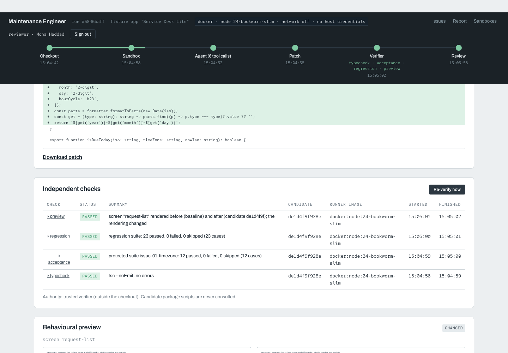

# AI Maintenance Engineer

**A patch needs proof.**

A coding agent can produce a persuasive diff without fixing the defect. AI Maintenance Engineer separates the agent's work from the checks that decide whether the patch is acceptable.

Built by **Mohammed Abumtary** · TypeScript · React · PostgreSQL · Docker sandbox · bounded coding-agent loop

[Demo guide](docs/DEMO.md) · [Engineering notes](docs/ENGINEERING.md) · [Verification & boundaries](docs/VERIFICATION.md) · [Recorded walkthrough](media/walkthrough.mp4)

## The experience

Choose an issue → run the agent → inspect its diff → compare independent checks.

A fresh live repair was recorded inside an isolated sample repository. The default browsing experience uses saved evidence with paid calls disabled.

## Where the engineering matters

### Keep the repository inside a sandbox

The live agent works through a bounded toolbox in Docker. Path and execution boundaries protect the host and unrelated projects.

### Keep acceptance evidence outside the agent's control

Protected acceptance cases, regressions and typechecking judge the proposed patch independently.

### Make the result inspectable

The reviewer sees the changed file, checks and preview before a local export; no automatic merge or real customer-repository action occurs.

## Verified in the demonstration

- A fresh recorded repair changed one time-handling module.
- 12 protected acceptance cases, 23 regression cases, typecheck and preview passed for that repair.
- Shared live-agent verification included 37 nonpaid tests and eight Docker boundary checks across Maintenance and Readiness.

## Explore the work

This repository is a presentation package: screenshots, walkthrough media and engineering notes. Application source, credentials and customer records are not included. The interactive demonstration runs in a separate local review environment; access can be arranged for a walkthrough.

[Read the guided demo](docs/DEMO.md) · [View my portfolio](https://mohammed-ab.github.io/)

## Scope

The successful repair is one controlled task, not a general claim that arbitrary bugs are solved. A saved recording is not presented as a new live run.

Reviewed 10 November 2026. Results describe the recorded build and stated test scope.
